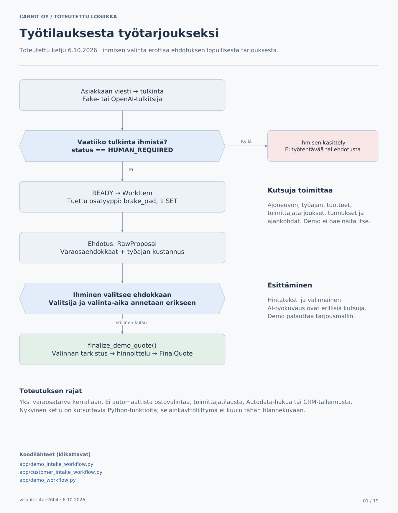
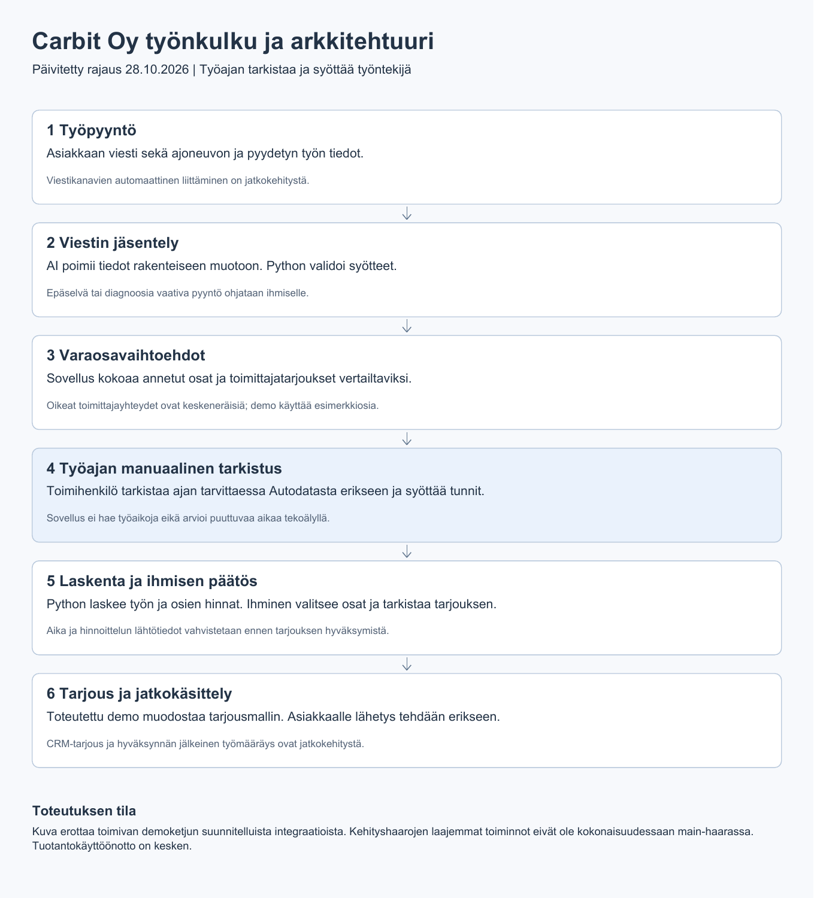

# Carbit Oy – arkkitehtuuri ja päätöspuut

Päivitetty 6.10.2026. Toteutetun logiikan lähde on [`4de26b4`](https://github.com/elissei/CarbitOy/tree/4de26b4284280fdd8c3867e01e8c38bcad718115), joka sisältää backend-muutokset commitin `0d8b03c` loppuun asti. Myöhemmät muutokset eivät päivity kuviin automaattisesti.

## Domain-vaihe 1: toteutettu 9.10.2026

Ajantasainen domain-lähde on [feature/autodata-labour, commit 6fb2e993](https://github.com/elissei/CarbitOy/tree/6fb2e9930e20235661aece6856c396d8db15a3a4).
[Domain-vaiheen 1 käsitekaavio ja tulevan työaikalaskennan rajaus](domain-vaihe-1.md)
erottaa toteutetun Side-käsitteen, operaation ja parivaihtokonfiguraation
suunnitellusta LabourPlan-laskennasta sekä myöhemmistä hyväksytyistä muutoksista.
Lähdehaaran vahvistettu testitulos on 158 läpäissyttä testiä.

Alla olevat 6.10.2026 PDF- ja PNG-päätöspuut ovat historiallinen tilannekuva;
niihin ei ole lisätty vaihetta 1, myöhempää web-työjonoa eikä uutta
build_raw_proposal-palvelua. Niiden lähdeversio säilyy alkuperäisenä.
Nykyiset domain- ja web-kuvaukset löytyvät
[arkkitehtuurista](../../saaga-docs/ARCHITECTURE.md).

## Toteutettu kokonaisketju — tilannekuva 6.10.2026

Asiakkaan viestin tulkinta yhdistyy ehdotukseen. Ihminen valitsee varaosaehdokkaan, minkä jälkeen erillinen viimeistelykutsu muodostaa lopullisen tarjouksen.

- [Kaikki päätöspuut PDF-muodossa](Carbit-toteutetut-paatospuut.pdf) – 19 sivua, klikattavat koodilähteet.
- [Nykyisten työnkulkujen muokattavat Mermaid-kaaviot](nykyiset-paatosketjut.md) – näkyvät myös Obsidianissa.

Demo käsittelee yhden varaosatarpeen. Kutsuja antaa ajoneuvon, työajan, tuotteet ja tarjoukset. Hintahaku toimittajan verkkopalvelusta, Autodata, CRM, pysyvä tallennus ja selainkäyttöliittymä eivät kuulu tähän toteutustilannekuvaan. Hintateksti ja valinnainen AI-työkuvaus pyydetään erikseen.

## Päätöspuut

| PDF-sivu | Sisältö | Kuva |
| --- | --- | --- |
| 1 | Nykyinen kokonaisketju | [PNG](decision-trees/Carbit-paatospuu-01.png) |
| 2 | Tekstistä varaosatarpeeksi: erillinen sanastoparseri | [PNG](decision-trees/Carbit-paatospuu-02.png) |
| 3 | Sanastohakujen apupuut | [PNG](decision-trees/Carbit-paatospuu-03.png) |
| 4 | Akselin tulkinta | [PNG](decision-trees/Carbit-paatospuu-04.png) |
| 5 | Tuotteen kattavuuden tarkistukset | [PNG](decision-trees/Carbit-paatospuu-05.png) |
| 6 | Akseli- ja yksikköapufunktiot | [PNG](decision-trees/Carbit-paatospuu-06.png) |
| 7 | Erillinen muunto kappaleiksi | [PNG](decision-trees/Carbit-paatospuu-07.png) |
| 8 | Pakkausmäärän laskenta | [PNG](decision-trees/Carbit-paatospuu-08.png) |
| 9 | Toimittajatarjouksen validointi | [PNG](decision-trees/Carbit-paatospuu-09.png) |
| 10 | Yhden ehdokkaan muodostaminen | [PNG](decision-trees/Carbit-paatospuu-10.png) |
| 11 | Kaikkien toimittajaehdokkaiden kokoaminen | [PNG](decision-trees/Carbit-paatospuu-11.png) |
| 12 | Hakuliitäntöjen silmukka: erikseen kutsuttava | [PNG](decision-trees/Carbit-paatospuu-12.png) |
| 13 | Varaosamallit, sanastot ja latauksen rajat | [PNG](decision-trees/Carbit-paatospuu-13.png) |
| 14 | Viestin tulkinta ja ihmiskäsittelyyn ohjaus | [PNG](decision-trees/Carbit-paatospuu-14.png) |
| 15 | Tulkinnasta työtehtäväksi ja varaosatarpeeksi | [PNG](decision-trees/Carbit-paatospuu-15.png) |
| 16 | Intake yhdistyy ehdotukseen | [PNG](decision-trees/Carbit-paatospuu-16.png) |
| 17 | Ihmisen valinnan tarkistukset | [PNG](decision-trees/Carbit-paatospuu-17.png) |
| 18 | Lopullisen tarjouksen hinnoittelu ja validointi | [PNG](decision-trees/Carbit-paatospuu-18.png) |
| 19 | Hintateksti ja AI-työkuvauksen raja | [PNG](decision-trees/Carbit-paatospuu-19.png) |

Sivujen otsikoissa oleva päätöspuun numero alkaa nollasta kokonaiskartan jälkeen; taulukossa käytetään PDF:n sivunumeroita. Sanastoparseri ja `search_suppliers()` ovat erillisiä toteutettuja työkaluja, joita viestistä ehdotukseen etenevä demo ei kutsu. `sort_by_total_price()` on erillinen apufunktio; demo säilyttää ehdokkaiden muodostusjärjestyksen.

## Tavoitearkkitehtuuri

Alla oleva 2.10.2026 laadittu kuva esittää projektin laajempaa tavoitetta. Sen suunnitellut liitännät eivät tarkoita, että ne olisivat toteutettuja. Ajantasainen toteutus näkyy yllä ja [Saagan arkkitehtuuridokumentissa](../../saaga-docs/ARCHITECTURE.md).

## Seuraavien päivitysten tekeminen

PDF ja PNG-kuvat tuotetaan samasta [Python-lähteestä](generate.py). Ajo vaatii `reportlab`- ja `PyMuPDF`-paketit sekä DejaVu Sans -fontit. WSL:ssä komento on `python3 docs/visualizations/generate.py`. Se korvaa PDF:n ja päätöspuukuvat; se ei muuta sovelluskoodia.

Kun logiikka muuttuu, tarkista Saaga-dokumentaatio ja koodi, päivitä kaaviolähteen ehdot sekä lähdecommit ja päiväys, tee vastaavat muutokset Mermaid-sivulle ja tarkista renderöidyt kuvat ennen commitia. Pelkkä generaattorin ajaminen ei tulkitse uutta koodia. Saaga ylläpitää `saaga-docs/`-kansiota; nämä visualisoinnit ylläpidetään erikseen.

[Edellinen 13-sivuinen tilannekuva 2.10.2026](https://github.com/elissei/CarbitOy/blob/713729636d0ced24194dcbfe466264477788c208/docs/visualizations/README.md) on säilynyt Git-historiassa.
