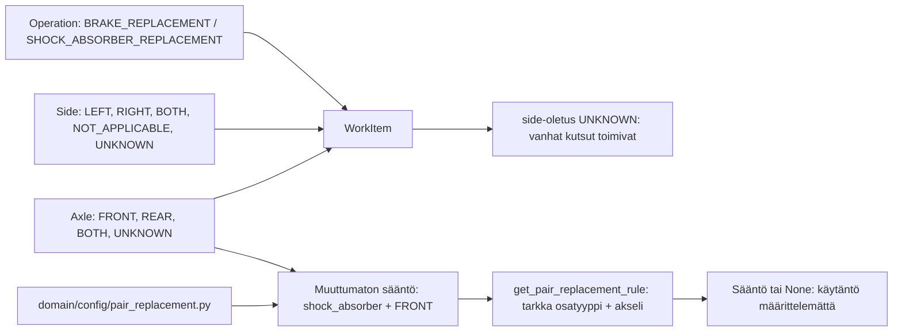
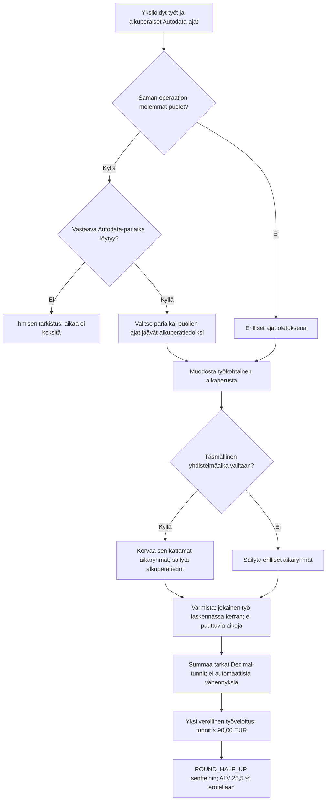
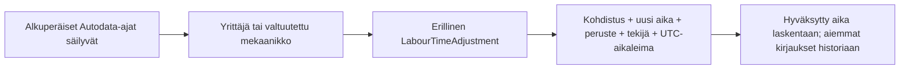

# Carbit Oy – domain-vaihe 1 ja työaikalaskennan suunnitelma

Päivitetty 9.10.2026. Toteutuksen lähde:
[feature/autodata-labour, 6fb2e993](https://github.com/elissei/CarbitOy/tree/6fb2e9930e20235661aece6856c396d8db15a3a4).
Lähdehaaran testitulos: 158 läpäissyttä testiä; tätä dokumentointipäivitystä
varten testejä ei ajettu. Visuals-haaran koodia ei mergetty lähdehaarasta.

## 1. Toteutettu käsite- ja riippuvuuskartta

Axle.BOTH tarkoittaa molempia akseleita, Side.BOTH saman akselin molempia
puolia. NOT_APPLICABLE ja UNKNOWN ovat eri tilanteita. Parivaihtokonfiguraatio
ei muuta WorkItem-oliota, varaosamäärää tai työaikaa. Se ei pakota parivaihtoa.
Muiden osatyyppien ja taka-akselin käytäntöjä ei oleteta.
Varaosien PAIR-yksikkö on erillinen määrä- ja pakkauskäsite.

Lähteet:
[Side](https://github.com/elissei/CarbitOy/blob/6fb2e9930e20235661aece6856c396d8db15a3a4/domain/models/enums.py),
[WorkItem](https://github.com/elissei/CarbitOy/blob/6fb2e9930e20235661aece6856c396d8db15a3a4/domain/models/work_item.py),
[parivaihtokonfiguraatio](https://github.com/elissei/CarbitOy/blob/6fb2e9930e20235661aece6856c396d8db15a3a4/domain/config/pair_replacement.py).

## 2. Suunniteltu LabourPlan — ei toteutettu

Yhdistelmäaika voi kattaa osan töistä; ulkopuoliset työt lisätään erikseen.
Puuttuvaa pariaikaa ei ratkaista summaan siirtymällä. Suunniteltu lopullinen tarjous
edellyttää kaikkien vaadittujen työaikojen ratkaisemista.

Pyöristysehdotus: 1,3355 h + 1,3355 h = 2,6710 h → 240,39 EUR.
Työkohtaisesti pyöristettyjen hintojen 240,40 EUR summaa ei käytetä.
Nykyinen palvelu hinnoittelee yhden annetun ajan; tämä kaavio ei kuvaa
olemassa olevaa monen työn laskentaa.

## 3. Myöhemmät hyväksytyt työaikamuutokset — ei toteutettu

Päällekkäiset purku- ja asennusvaiheet eivät vähennä aikaa automaattisesti.
Muutos tarvitsee perustelun ja valtuutetun hyväksyjän. Autodata-alkuperää
ei muuteta hyväksytyn poikkeaman lähteeksi. Työn tai aikaperustan muuttuminen
edellyttää muutoksen uudelleentarkistusta. MANUAL_AUTODATA-kirjaus,
HumanSelection ja nykyinen web-tapahtumahistoria eivät toteuta tätä hyväksyntää.

## Nykyisen käyttöpolun rajat

RawProposal ja FinalQuote kuvaavat edelleen yhden WorkItem-olion.
Demo on ennallaan ja hyväksyy yhden varaosavaatimuksen.
Tarjouspohjan tekstimuotoilija tuntee vain BRAKE_REPLACEMENT-operaation.
Uusi kohdepuoli ei vielä välity AI-työkuvauksen syötteeseen tai web-lomakkeeseen.
Domain-vaihe 1 ei ole valmis monen työn tarjous- tai Autodata-integraatio.

Katso [arkkitehtuuri](../../saaga-docs/ARCHITECTURE.md),
[käsitteet](../../saaga-docs/concepts/work-and-part-data.md),
[päätöslogiikka](../../saaga-docs/features/proposal-decisions.md) ja
[päätösloki](../notes/paatokset.md).
