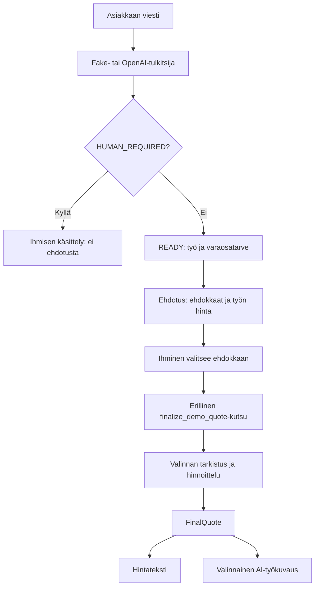
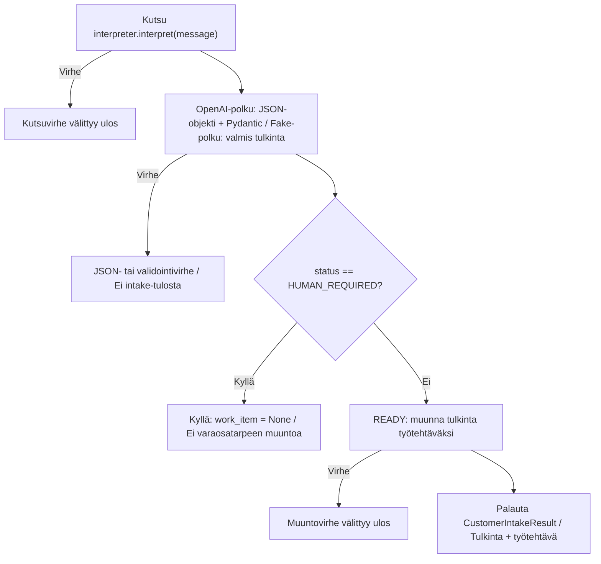
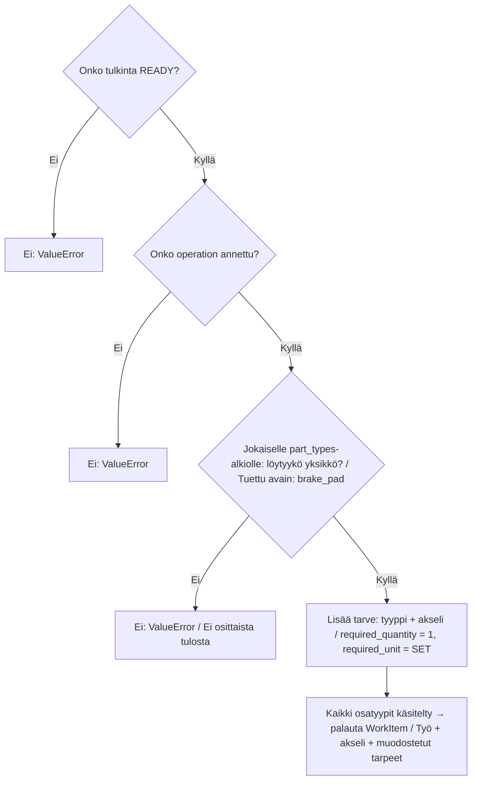
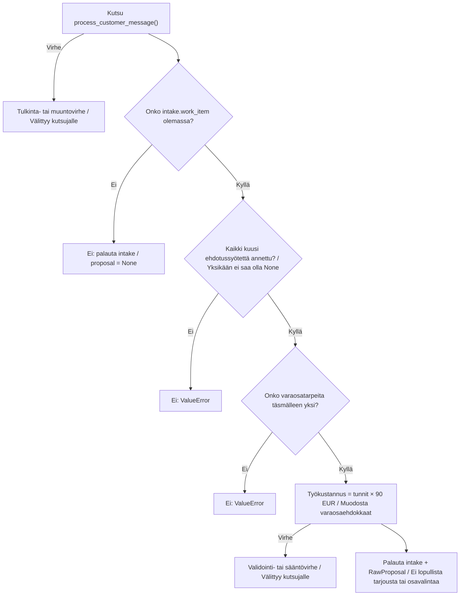
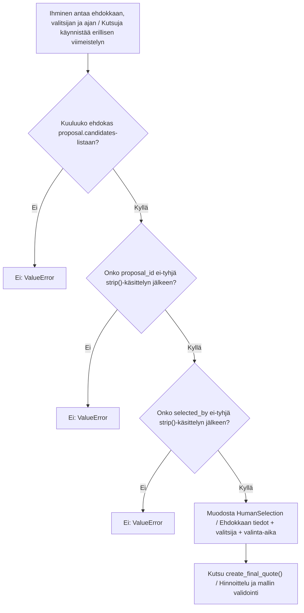
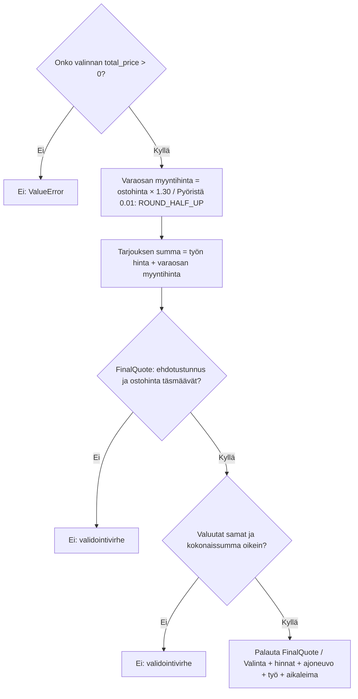
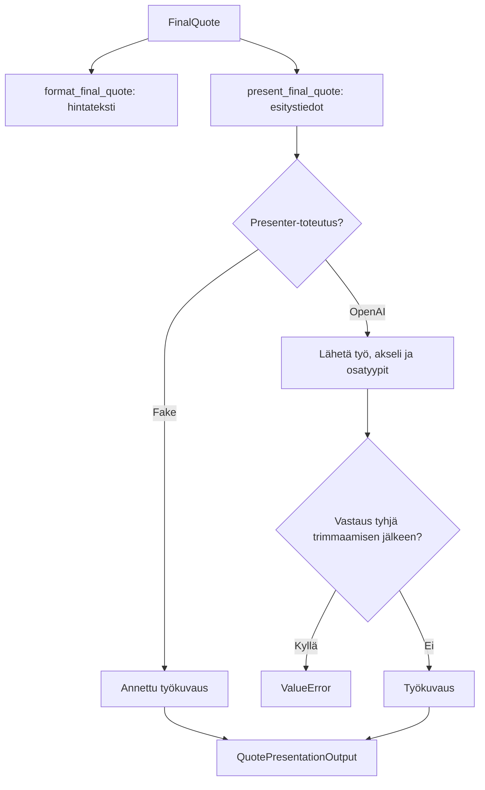

# Carbit Oy – nykyiset työnkulut ja päätösketjut

Tilannekuva 6.10.2026, lähdekoodi [`4de26b4`](https://github.com/elissei/CarbitOy/tree/4de26b4284280fdd8c3867e01e8c38bcad718115). Kaaviot renderöityvät GitHubissa ja Obsidianissa. Vain toteutettu logiikka; toimittajatilaukset, CRM, Autodata ja selain-UI eivät kuulu tähän tilannekuvaan.

> Tämä sivu säilyttää 6.10.2026 työnkulut. Uudempi domain-toteutus
> ja suunnitelmien tilat: [Domain-vaihe 1](domain-vaihe-1.md).
> Uusi parivaihtokonfiguraatio ei lisää Autodata-aikavalintaa näihin ketjuihin.

## Kokonaisketju

Kutsuja antaa ajoneuvon, työajan, tuotteet ja toimittajatarjoukset. Demo hyväksyy yhden varaosatarpeen. Hintateksti ja työkuvaus pyydetään erikseen; demo ei yhdistä niitä tai lähetä tarjousta asiakkaalle. Poikkeukset välittyvät kutsujalle.

## 13 · Viestin tulkinta ja ihmishaara

`process_customer_message() ja OpenAI-tulkinnan validointi`

READY vaatii työn ja vähintään yhden osatyypin. Diagnoositarve vaatii HUMAN_REQUIRED-tilan. AI-prompti ohjaa epävarmat pyynnöt ihmiselle, mutta jokaista promptiehtoa ei validoida koodissa. Virheitä ei muuteta automaattisesti ihmishaaraksi.

Lähteet: [app/customer_intake_workflow.py](https://github.com/elissei/CarbitOy/blob/4de26b4284280fdd8c3867e01e8c38bcad718115/app/customer_intake_workflow.py), [domain/models/customer_request.py](https://github.com/elissei/CarbitOy/blob/4de26b4284280fdd8c3867e01e8c38bcad718115/domain/models/customer_request.py), [integrations/ai/openai_customer_request_interpreter.py](https://github.com/elissei/CarbitOy/blob/4de26b4284280fdd8c3867e01e8c38bcad718115/integrations/ai/openai_customer_request_interpreter.py).

## 14 · Tulkinnasta varaosatarpeeksi

`build_work_item_from_customer_request() · jokainen osatyyppi käsitellään`

Jokaisesta brake_pad-esiintymästä tulee oma tarve; duplikaatteja ei poisteta. UNKNOWN-akseli kopioidaan sellaisenaan. Demo hyväksyy myöhemmin vain yhden tarpeen. Suoraan kutsuttu muuntaja ei itse tarkista osatyyppilistan tyhjyyttä.

Lähteet: [domain/rules/customer_request_work_item.py](https://github.com/elissei/CarbitOy/blob/4de26b4284280fdd8c3867e01e8c38bcad718115/domain/rules/customer_request_work_item.py), [domain/models/customer_request.py](https://github.com/elissei/CarbitOy/blob/4de26b4284280fdd8c3867e01e8c38bcad718115/domain/models/customer_request.py), [domain/models/part_requirement.py](https://github.com/elissei/CarbitOy/blob/4de26b4284280fdd8c3867e01e8c38bcad718115/domain/models/part_requirement.py).

## 15 · Intake yhdistyy ehdotukseen

`process_demo_customer_message() → create_demo_proposal()`

Kuusi syötettä: proposal_id, vehicle, labour_time, products, offers, created_at. Tyhjät tuote- ja tarjouslistat sallitaan: ehdokaslista voi olla tyhjä. Demo ei lajittele ehdokkaita eikä hae työaikaa tai tarjouksia itse.

Lähteet: [app/demo_intake_workflow.py](https://github.com/elissei/CarbitOy/blob/4de26b4284280fdd8c3867e01e8c38bcad718115/app/demo_intake_workflow.py), [app/demo_workflow.py](https://github.com/elissei/CarbitOy/blob/4de26b4284280fdd8c3867e01e8c38bcad718115/app/demo_workflow.py), [domain/rules/labour_cost.py](https://github.com/elissei/CarbitOy/blob/4de26b4284280fdd8c3867e01e8c38bcad718115/domain/rules/labour_cost.py).

## 16 · Ihmisen valinnan tarkistukset

`finalize_demo_quote() → create_demo_final_quote() → select_candidate_from_proposal()`

Jäsenyys tarkistetaan listan in-operaatiolla eli mallien yhtäsuuruudella. Tarkistus ei todenna valitsijan henkilöllisyyttä. Valinta tallennetaan palautettavaan malliin; pysyvää tietokantatallennusta tai toimittajan ostotilausta ei tehdä.

Lähteet: [app/demo_intake_workflow.py](https://github.com/elissei/CarbitOy/blob/4de26b4284280fdd8c3867e01e8c38bcad718115/app/demo_intake_workflow.py), [app/demo_workflow.py](https://github.com/elissei/CarbitOy/blob/4de26b4284280fdd8c3867e01e8c38bcad718115/app/demo_workflow.py), [domain/rules/human_selection.py](https://github.com/elissei/CarbitOy/blob/4de26b4284280fdd8c3867e01e8c38bcad718115/domain/rules/human_selection.py).

## 17 · Lopullisen tarjouksen hinnoittelu

`create_final_quote() · laskenta tehdään domain-säännöissä`

Kerroin 1.30 on 30 prosentin lisä ostohintaan, ei 30 prosentin myyntikate. Käytetään valinnan kokonaisostohintaa, ei yksikköhintaa. Tässä ketjussa ei lasketa erillistä ALV-erittelyä. Malli tarkistaa summan mutta ei itse uudelleenlaske kerrointa.

Lähteet: [domain/rules/part_sale_price.py](https://github.com/elissei/CarbitOy/blob/4de26b4284280fdd8c3867e01e8c38bcad718115/domain/rules/part_sale_price.py), [domain/rules/final_quote.py](https://github.com/elissei/CarbitOy/blob/4de26b4284280fdd8c3867e01e8c38bcad718115/domain/rules/final_quote.py), [domain/models/final_quote.py](https://github.com/elissei/CarbitOy/blob/4de26b4284280fdd8c3867e01e8c38bcad718115/domain/models/final_quote.py).

## Esittäminen ja AI-raja

AI-työkuvaukseen ei lähetetä ajoneuvon tunnuksia, hintoja tai työaikaa. Hintateksti tulostaa euron ja ALV-merkinnän kiinteästi; tässä ketjussa ei tehdä erillistä verolaskentaa. Kutsuja yhdistää hintatekstin ja työkuvauksen. Verkkovirheet välittyvät ulos, eikä retry- tai fallback-haaraa ole.
