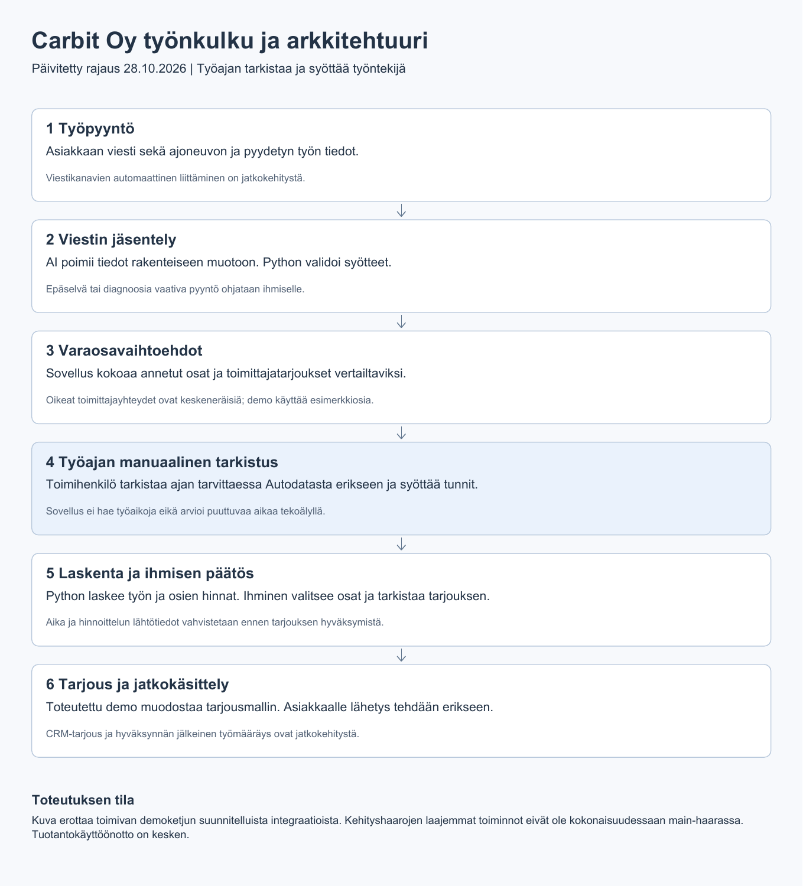
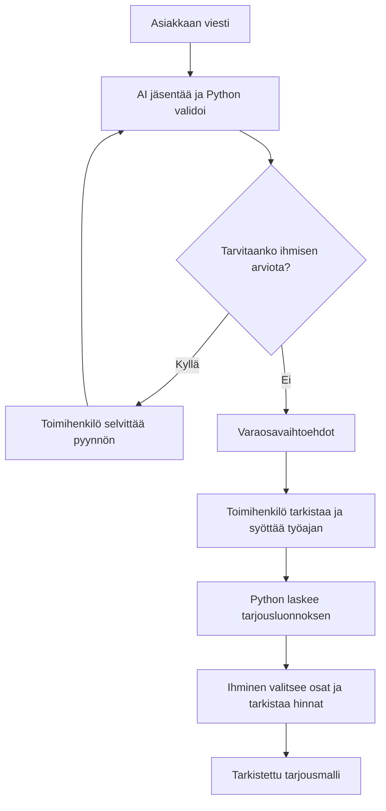

# Carbitin työnkulku
Päivitetty 28.10.2026.

## Rajaus
Automaattinen työaikahaku on poistettu tavoitellusta työnkulusta. Toimihenkilö tarkistaa korjaus- tai huoltotyön ajan tarvittaessa Autodatasta erikseen ja syöttää tunnit sovellukseen. Autodata ei ole sovelluksen integraatio. Tekoäly ei keksi puuttuvaa työaikaa.

## Viestistä tarjousluonnokseen

Varaosavaihtoehdot voivat demossa olla esimerkkitietoja. Oikeiden toimittajien integraatiot ovat erillistä jatkokehitystä. Laskenta käyttää syötettyä työaikaa; työajan hakua ei korvata toisella automaattisella lähteellä.

## Toteutettu ja suunniteltu
- Main-haaran demoketju sisältää viestin tulkinnan, rakenteisen validoinnin, ihmisen varaosavalinnan ja sääntöpohjaisen tarjouslaskennan. Kutsuja antaa työajan ja varaosatiedot.
- Laajempi selain-, tunnistautumis- ja tallennustoteutus sijaitsee kehityshaaroissa. Tämä dokumentointipäivitys ei siirrä niitä main-haaraan.
- Viestikanavat, oikeat toimittajayhteydet, CRM-tarjoukset ja hyväksynnän jälkeiset työmääräykset ovat keskeneräistä jatkokehitystä. Tuotantokäyttöönotto on kesken.
- Puuttuva aika selvitetään ihmisen toimesta ennen tarjouksen hyväksymistä. Tämä on käyttöprosessin vaatimus, ei väite uuden käyttöliittymäeston toteutuksesta.

## Demon esitystapa
Näytä asiakkaan viesti, tulkinta, varaosavaihtoehdot, työntekijän antama esimerkkityöaika, ihmisen valinta ja laskennan tulos. Kerro erikseen, mitkä tiedot ovat esimerkkitietoja. Älä esittele automaattista työaikahakua tai keskeneräistä integraatiota toimivana ominaisuutena.

Historialliset päätöspuut kuvaavat niihin merkittyä lähdekoodiversiota. Työajan kustannuslaskenta säilyy: manuaalinen syöttö korvaa vain tietojen haun.
